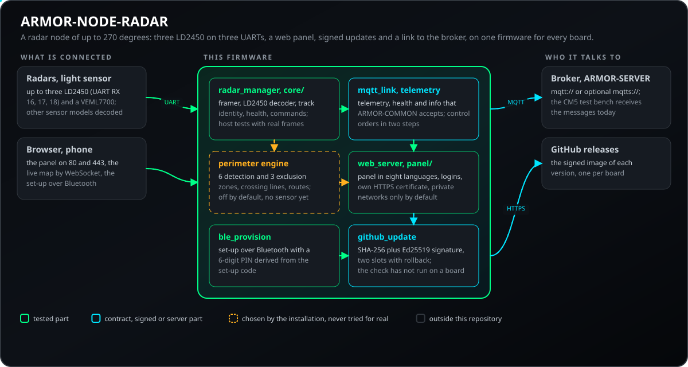
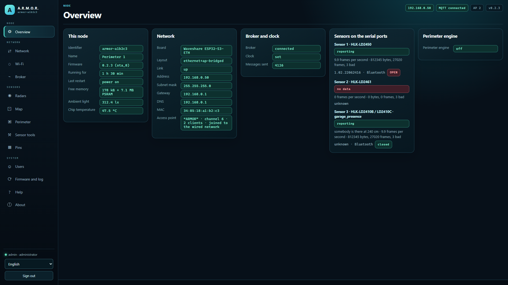
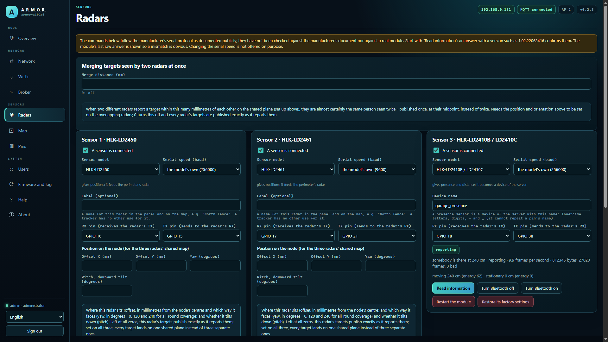
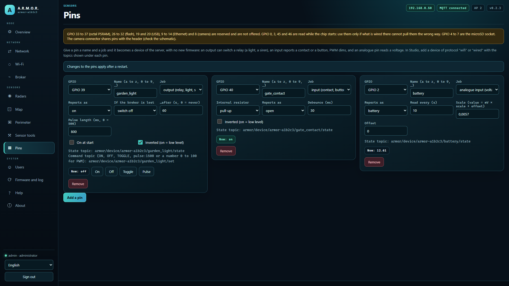
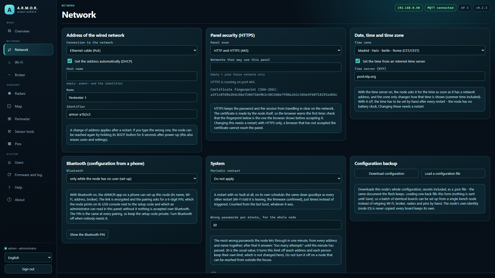
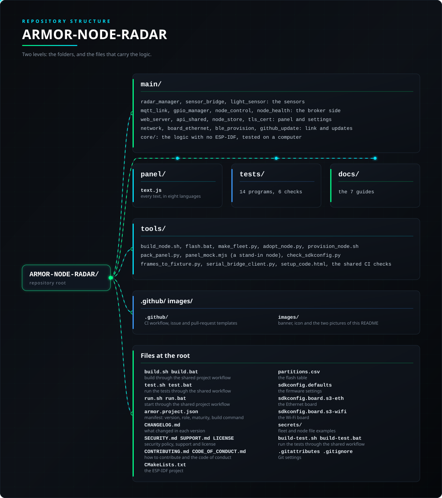

<p align="center">
  
</p>

# 📡 ARMOR-NODE-RADAR

<p align="center">
  <a href="README.md">🇺🇸 English</a> |
  <a href="README_spa.md">🇪🇸 Español</a> |
  <a href="README_fra.md">🇫🇷 Français</a> |
  <a href="README_ita.md">🇮🇹 Italiano</a> |
  🇩🇪 <b>Deutsch</b> |
  <a href="README_zho.md">🇨🇳 简体中文</a> |
  <a href="README_jpn.md">🇯🇵 日本語</a> |
  <a href="README_por.md">🇵🇹 Português</a>
</p>

### Feldknoten-Firmware (Waveshare ESP32-S3-ETH, drei Radare oder Präsenzsensoren, Ethernet und WLAN) mit eigenem Web-Panel und ihrem am Rechner getesteten Kern

<p align="center">
  
  
  
  
  
  
</p>

---

**Ehrlichkeitsprüfung - was heute läuft:** Der Radarknoten ist der einzige Knoten, der als Hardware existiert: Seine Firmware läuft auf einer echten Waveshare-ESP32-S3-ETH-Platine mit einem Radar und meldet an den CM5-Testaufbau, und sein Web-Panel und die Over-the-Air-Updates werden dort genutzt. Der hardwareunabhängige Kern (4,633 Prüfungen in 14 Testprogrammen: die Decoder des LD2450, des LD2461 und von vier Präsenzsensoren, der Befehlskanal des LD2450, die Einstellungen und ihre Prüfungen, die Pin-Tabelle, Benutzer und Sitzungen, der Netzplan, der Nachrichten-Serialisierer, dessen Ausgabe ARMOR-COMMON akzeptiert, und die Versions- und Signaturprüfungen) wird auf einem Computer getestet, das **Web-Panel** wurde in einem echten Browser gegen einen Ersatzknoten geprüft und das **Firmware-Abbild baut** im ESP-IDF-5.5.5-Container. **Noch nicht** bewiesen: Die Decoder des LD2461 und der Präsenzsensoren entsprechen nur den durchgerechneten Beispielen ihrer Handbücher, ohne Modul dahinter; die Signaturprüfung der Updates und die Bluetooth-Kopplung mit PIN sind auf dem Computer mit echten Signaturen bewiesen, aber noch nicht auf der Platine; der Befehlskanal des Radars ist nicht gegen ein Modul geprüft; und das HTTPS-Zertifikat des Panels (vom Knoten selbst erzeugt) ist nicht in allen Browsern erprobt.

---

## 📋 Auf einen Blick

| | |
|---|---|
| Version | `0.8.0.5` |
| Reifegrad | Etabliert |
| Rolle | Radar-Feldknoten für ESP32-S3 (Familie: Field Nodes, übergeordnet: ARMOR-COMMON) |
| Technik | C++17, ESP-IDF 5.5.5, ESP32-S3 |
| Tests | 7371 Prüfungen in 14 Host-Programmen und 6 Python-Prüfungen (`ctest`) |
| Platinen | Waveshare ESP32-S3-ETH (Ethernet) und ESP32-S3-WROOM-1 N16R8 (nur WLAN) |
| Sensoren | Bis zu 3 Radare (LD2450, LD2461) oder Präsenzsensoren je Knoten, Lichtsensor VEML7700 |
| Läuft auf | Waveshare ESP32-S3-ETH oder ESP32-S3-WROOM-1 N16R8; Host-Tests auf jedem Computer |
| Auf echter Hardware | Läuft auf einer echten Waveshare-ESP32-S3-ETH-Platine mit einem Radar und meldet an den CM5-Testaufbau |
| Lizenz | GPL-3.0-or-later |

**Springe zu:** [Überblick](#-überblick) · [Architektur](#-architektur) · [Sicherheit](#-sicherheit-und-schutz) · [Schnittstellen](#-schnittstellen) · [Konfiguration](#-konfiguration) · [Schnellstart](#-schnellstart) · [Tests](#-tests) · [Probleme](#-fehlerbehebung) · [Struktur](#-struktur-des-repositorys) · [Verwandte](#-verwandte-projekte)

## 🚦 Projektstatus

Jede Zeile ist ein Teil dieses Repositorys, und die Ampel sagt, wie weit er heute ist. Sie beruht auf dem, was das Repository zeigen kann (Tests, Builds, Läufe), nicht auf dem, was geplant ist.

🟢 Fertig und überprüft · 🟡 Funktioniert, mit bekannten Grenzen · 🟠 Teilweise fertig oder noch nicht überprüft · 🔴 Nicht gemacht oder funktioniert nicht

| Bereich | Stand | Was das hier bedeutet |
|---|---|---|
| Software | 🟢 | Die Firmware wird im ESP-IDF-5.5.5-Container gebaut und läuft auf einer echten ESP32-S3-ETH-Platine. |
| Tests | 🟢 | 7.371 Prüfungen in 14 Host-Programmen bestehen (`ctest`): die Dekoder, die Einstellungen, die Pin-Tabelle, die Benutzer, der Netzplan, der Nachrichten-Serialisierer und die Versionsprüfungen. |
| Protokolle und Daten | 🟡 | Der LD2450 läuft an einem echten Radar; die Dekoder des LD2461 und der vier Anwesenheitssensoren stimmen nur mit den Beispielen ihrer Handbücher überein, und der Befehlskanal des Radars ist nicht an einem Modul geprüft. |
| Oberfläche | 🟡 | Das Web-Panel wird auf der Platine genutzt und in einem echten Browser gegen einen nachgebildeten Knoten erprobt; sein vom Knoten selbst erzeugtes HTTPS-Zertifikat ist nicht in jedem Browser erprobt. |
| Hardware | 🟡 | Es ist der einzige Knoten, den es als Hardware gibt: eine echte Waveshare-ESP32-S3-ETH-Platine mit einem Radar meldet an den CM5-Prüfstand; kein anderes Sensormodul ist angeschlossen. |
| Sicherheit | 🟡 | Die Kopplung per Bluetooth-PIN und die Prüfung der Update-Signatur sind auf einem Rechner mit echten Signaturen belegt, aber noch nicht auf der Platine; es gab keine unabhängige Prüfung. |
| Aktualisierungen | 🟡 | Aktualisierungen über die Luft werden auf der Platine genutzt; die Prüfung signierter Aktualisierungen lief dort noch nicht. |
| Integration | 🟢 | Die Nachrichten der Platine erreichen den Server des CM5-Prüfstands, und dieselben Nachrichten werden von den gemeinsamen Schemas und Konformitätsvektoren von ARMOR-COMMON akzeptiert. |
| Dokumentation | 🟢 | Acht Sprachen und das Änderungsprotokoll sind aktuell. |

## 🎯 Überblick

* **Zwei Platinen, eine Firmware:** die Waveshare ESP32-S3-ETH (Ethernet, Standard) und ein ESP32-S3-WROOM-1 N16R8 ohne Ethernet (nur WLAN: die Einrichtung fragt nach dem WLAN zum Beitreten, und der Knoten behält immer sein eigenes Netz). Das Image wird beim Bauen gewählt (`tools/build_node.sh generic s3-eth` oder `generic s3-wifi`); Pin-Tabelle und Zugangsweg folgen der Platine, das Panel blendet aus, was die Platine nicht hat, und ein Image gilt nur für seine Platine. Beide bauen und sind am Rechner getestet; keine lief je auf einer Platine.
* **Ein Knoten deckt bis zu 270 Grad ab:** jedes Waveshare ESP32-S3-ETH liest bis zu drei LD2450-Radare an seinen drei UARTs, im Abstand von 75 Grad montiert, über kabelgebundenes Ethernet (W5500) mit DHCP oder fester Adresse, gespeist per PoE oder USB. Studios *Add a 270° node* legt die drei Radare bereits dem Knoten zugeordnet an.
* **Ein Web-Panel auf jedem Knoten,** im Aussehen von Studio und in acht Sprachen, in die Firmware eingebettet: Übersicht, Netzwerk, WLAN, Broker, Radare, Pins, Benutzer, Firmware-Update und Protokoll. Ein Knoten ohne Benutzer öffnet das WLAN `ARMOR-SETUP-xxxxxx` und legt mit einem Einrichtungscode seinen ersten Administrator an; Passwörter sind gesalzenes PBKDF2, Sitzungen zufällige Token, und jede Einstellung liegt im Flash des Knotens, sodass ein Image alle Knoten bedient und kein Passwort einkompiliert ist ([das Panel](docs/NODE_PANEL.md)).
* **Ein WLAN aus vielen Knoten:** jeder Knoten kann einen an seinen Ethernet-Port angebundenen Access Point anbieten; mit gleichem Namen und Passwort und dem Kanal auf automatisch (1, 6 oder 11 nach MAC) sehen Telefone und WLAN-Sensoren ein Netz mit einem DHCP-Server. Es ist kein Funk-Mesh: jeder Knoten behält sein Kabel. Ein Knoten kann stattdessen dem WLAN eines Routers beitreten (mit Netzwerksuche), und einer ohne Kabel lässt sich per **Bluetooth** über die Android-App konfigurieren.
* **Pins für den Server:** jeder freie Pin wird zu einem Eingang, einem Ausgang (mit sicherem Zustand bei Verlust des Brokers), PWM oder einer analogen Messung und erscheint als Gerät des Servers, sodass ein Relais oder ein Kontakt keine neue Firmware braucht. Die reservierten Pins der Platine werden nie angeboten.
* **Over-the-Air-Updates mit Rollback** aus dem Panel (zwei Slots im 16-MB-Flash) und ein **Link aus Studio** zum Panel jedes Knotens, über die Adresse, die der Knoten veröffentlicht.
* **Das Panel über HTTPS:** der Knoten erzeugt sein eigenes Zertifikat (selbstsigniert, im Flash gehalten) und bedient das Panel auf Port 443 zusätzlich zu 80 oder nur auf 443; das Sitzungs-Cookie ist als Secure markiert und der Fingerabdruck des Zertifikats wird zum Vergleich mit der Browserwarnung angezeigt.
* **Stabile Spur-Identitäten:** die Ziele jedes Rahmens werden den zuvor verfolgten zugeordnet, sodass eine Person dieselbe Spur-ID behält, ein verlorener Rahmen nicht flackert und die Positionen leicht geglättet werden.
* **Sechs Sensormodelle, eines je Port:** ein Port trägt einen LD2450 oder LD2461 (Tracker, die den Perimeter speisen, mit dem eigenen Feld des Modells in Studio) oder einen Präsenzsensor (LD2410, LD2412, LD2410S, MR24HPC1), der zum Gerät des Servers wird und Anwesenheit und Entfernung veröffentlicht. Im Panel gewählt; was jeder ist, sein Protokoll und was nicht geprüft wurde, steht in `docs/SENSORS.md`.
* **LD2450-Dekoder, Zustand und Konfiguration:** ein neu synchronisierender Rahmenfinder findet Rahmen in einem verrauschten Strom; jeder 30-Byte-Rahmen liefert bis zu drei Ziele, die zu Vertragsspuren werden; Konsole und Panel sagen je Radar, ob es meldet, schweigt oder Unsinn sendet. Das Panel kann auch die Version des Moduls lesen, ein oder drei Ziele wählen und Erkennungszonen setzen (ein an einem Modul ungeprüftes Protokoll).
* **Umgebungslicht und vertragsgenaue Nachrichten:** der VEML7700 mit automatischem Bereich; Telemetrie-, Zustands- und Informations-JSON folgt den veröffentlichten Schemas und weigert sich, Ungültiges zu schreiben, mit Wanduhr-Zeitstempeln (SNTP) und einem MQTT-Last-Will. Telemetrie wird zurückgehalten, solange kein Radar meldet, nie eine leere „Entwarnung“.
* **Ein Image für jede Platine, wie ein Netzwerkprodukt:** die Firmware ist dieselbe und die MAC unterscheidet die Platinen (`armor-` und sechs Ziffern bis zur Benennung); `adopt_node.py` gibt einem frisch geflashten Knoten über das Netzwerk seinen Administrator, seine Broker-Identität und die gemeinsamen Einstellungen der Flotte, mit einem aus seiner MAC berechneten Einrichtungscode: 5 Knoten oder 27 sind dieselbe Arbeit.
* **Werkzeuge am Prüfstand:** Flashen per USB-C, ein Stellvertreter-Knoten zum Arbeiten am Panel und ein Konverter von einem Protokoll roher Rahmen zu einem Testfixture ([Inbetriebnahme am Prüfstand](docs/BENCH_BRINGUP.md)).
* **Signierte Over-the-Air-Updates:** der Knoten installiert von GitHub nur ein Abbild, dessen SHA-256 stimmt und das eine gültige Ed25519-Signatur des Betreuers trägt (der öffentliche Schlüssel steckt in der Firmware, der private verlässt den Betreuer nie); eine von einem Administrator im Panel von Hand hochgeladene Datei wird weiterhin akzeptiert. Seiten und Meldungen des Panels sind in acht Sprachen.
* **Bluetooth-Kopplung mit PIN:** die sechsstellige PIN wird aus dem Einrichtungscode abgeleitet, auf der USB-Konsole ausgegeben und einem Administrator im Panel angezeigt; das Telefon muss sie eingeben, bevor es die Einstellungen des Knotens schreiben darf.
* **Nur das Haus darf das Panel nutzen:** Das Panel antwortet standardmäßig dem privaten Netz (oder den Netzen, die der Besitzer nennt, etwa einem VPN), lehnt eine Liste ab, die den Speichernden aussperren würde, zählt falsche Passwörter je Person und je Adresse und funktioniert hinter dem Proxy des Servers, sodass man es von außerhalb des Hauses erreicht, ohne den Knoten zu veröffentlichen.
* **Optionale verschlüsselte Verbindung zum Broker (TLS):** standardmäßig aus, der Knoten spricht also wie bisher unverschlüsseltes MQTT. Ein Schalter und ein Feld für das Zertifikat der eigenen Zertifizierungsstelle der Anlage (PEM, höchstens 2 KB) auf der Broker-Seite sorgen dafür, dass er sich mit `mqtts://` verbindet, nur dieser Stelle vertraut und prüft, ob das Zertifikat des Brokers für die erreichte Adresse ausgestellt wurde; alles, was nicht genau ein PEM-Zertifikat ist, wird abgelehnt. Durch Host-Tests abgedeckt; der Handshake wurde auf einer Platine noch nicht ausgeführt.
* **Zustandsbericht:** etwa einmal pro Minute veröffentlicht der Knoten, wie lange er läuft und warum er zuletzt neu gestartet ist, seinen freien Speicher, seine Verbindung und sein WLAN-Signal, wie oft er sich mit dem Broker verbunden hat und den letzten protokollierten Fehler (`armor/health/<Knoten>`, der Vertrag `node_health` von ARMOR-COMMON). Der Code, der ihn erzeugt, wird von allen Knoten geteilt und auf einem Computer getestet; auf einer Platine ist er noch nicht gelaufen.
* **Steuerung vom Server aus:** Studio kann den Knoten sauber neu starten, bis zu einer Stunde pausieren (er läuft von selbst weiter), seine Arbeit in den Standby setzen (ohne Ende, über Neustarts hinweg gespeichert, der Knoten bleibt verbunden und antwortet weiter), ihn sich zeigen lassen, einen Diagnose-Schnappschuss anfordern und ihn als in Wartung markieren (`armor/control/<Knoten>/...`, der Vertrag `node_control` von ARMOR-COMMON). Jeder Befehl besteht aus zwei Schritten mit einem Einmal-Token, das zu dieser Operation gehört; nur der Server darf sie am Broker schreiben, und es gibt kein Zurücksetzen auf Werkseinstellungen, kein Löschen und keinen Tiefschlaf. Solange der Knoten pausiert oder im Standby ist, veröffentlicht er weder Ziele noch Anwesenheit (der Herzschlag meldet weiter, dass er da ist). Der Code wird von allen Knoten geteilt und auf einem Rechner getestet; auf einer Platine ist er noch nicht gelaufen.
* **Eine Perimeter-Engine auf dem Knoten (standardmäßig aus):** sechs Erkennungszonen und drei Ausschlusszonen, jeweils ein Rechteck, das um einen Winkel gedreht werden kann, drei Stolperdrahtlinien, die Überschreitungen nach Richtung zählen, drei Eintrittspfade, Haustier-Immunität und Maskierungserkennung. Sie läuft neben den Sensoren, funktioniert also auch ohne Broker-Verbindung, behält ihre Ereignisse, solange der Broker fehlt, und veröffentlicht sie auf `armor/radar/<Knoten>/events`; der Zoneneditor ist im Panel des Knotens. Nichts davon ist bisher mit einem Sensor auf einer Platine gelaufen.
* **Wer jeder Sensor ist, und sein eigenes Bluetooth geschlossen:** Beim Start liest der Knoten Firmware-Version und Bluetooth-Adresse jedes Sensors, schließt standardmäßig das eigene Bluetooth der Sensoren (es verlangt keine PIN) und kann die serielle Leitung eines Sensors für einige Minuten an ein PC-Werkzeug eines Administrators übergeben (eine transparente serielle Brücke). `GET /metrics` für Administratoren sowie Export und Alles-oder-nichts-Import der Einstellungen runden es ab.
* **Diagnose ohne Kabel:** Nach einem unsauberen Start (Absturz, Watchdog, Spannungseinbruch, fehlgeschlagene Speicherreservierung) nennt der Gesundheitsbericht zehn Minuten lang den Grund; ein Absturz hinterlässt sein Core-Dump, das man im Panel ansehen, herunterladen oder löschen kann; die gespeicherten Einstellungen werden vor jeder Firmware-Installation kopiert und wiederhergestellt, falls ein Update sie beschädigt; und ein Administrator kann den Knoten über den Server mit einem Einmal-Token nach einem Diagnosepaket oder seinem Protokoll fragen.
* **Übernahme per HTTPS mit festgelegtem Fingerabdruck:** `tools/adopt_node.py` akzeptiert `https://<Adresse>` mit `--fingerprint` (der SHA-256 des Knotenzertifikats, geprüft auf der Verbindung, die die Anfrage trägt) oder `--show-fingerprint`, um ihn zu lesen; es warnt vor unverschlüsseltem HTTP und vor einer Flottendatei mit fester Adresse oder Hostnamen, und auch das Panel warnt beim Import einer solchen Datei.
* **Der Sensorleser wartet auf Ereignisse statt abzufragen:** Die Lese-Task schläft auf den Ereigniswarteschlangen der seriellen Leitungen und leert alles Eingegangene, leert die Leitung bei einem Überlauf und zählt Überläufe und Fehler je Leitung; `system.reader_idle_ms` (100; 0 = die frühere Abfrage im 10-ms-Takt) legt die Wartezeit fest, und eine ausfallende Warteschlange führt von selbst zur Abfrage zurück.
* **Optionales Versiegeln gespeicherter Geheimnisse:** standardmäßig aus (`security.seal_secrets` oder `nodes.nvs_encryption` des Servers). Eingeschaltet werden die Passwörter, Token, Schlüssel, PINs und Passwort-Hashes, die der Knoten speichert, mit ChaCha20-Poly1305 versiegelt, alles andere bleibt lesbar; Ein- und Ausschalten schreibt sie ohne Verlust um, auch wenn der Knoten mittendrin stehen bleibt. Es wird kein eFuse gebrannt und der Flash nicht verschlüsselt: Der Schlüssel liegt in einer Partition desselben Chips und schützt daher **nicht** vor jemandem, der die Platine hat; ein Knoten, der vor dieser Partition installiert wurde, behält seine Geheimnisse unverändert, bis er mit der neuen Partitionstabelle geflasht wird.

## 🧩 Rolle in A.R.M.O.R.

ARMOR-NODE-RADAR sind die Augen des Perimeters. Jeder Knoten liest bis zu drei Radare oder Präsenzsensoren und veröffentlicht Spuren, Licht und Zustand per MQTT an [ARMOR-SERVER](https://github.com/JuanenRac/ARMOR-SERVER); [ARMOR-STUDIO](https://github.com/JuanenRac/ARMOR-STUDIO) zeichnet sie in den Standortplan, und [ARMOR-SERVER-AI](https://github.com/JuanenRac/ARMOR-SERVER-AI) wägt sie gegen die Kameras ab. Seine Firmware teilt eine Basis mit den anderen Knoten (Panel, Bluetooth-Einrichtung, signierte Updates, Anmeldung und Uhr stammen aus der Firmware-Basis von [ARMOR-COMMON](https://github.com/JuanenRac/ARMOR-COMMON)), sodass das, was man an einem Knoten lernt, für alle gilt.

| Name | Wie | Wozu |
|---|---|---|
| ARMOR-SERVER | MQTT `armor/node/<id>/telemetry|health|info|command` | Empfängt die Radarnachrichten (heute der CM5-Prüfstand) und steuert den Knoten |
| ARMOR-STUDIO | Link zum Panel | Öffnet das Panel des Knotens unter der vom Knoten veröffentlichten Adresse |
| ARMOR-ANDROID-CONTROL | Bluetooth | Richtet den Knoten vor Ort ein |
| ARMOR-COMMON | Verträge, Firmware-Basis | Die Nachrichten werden gegen seine Schemas geprüft; die gemeinsame Firmware stammt daraus |

## 🏛️ Architektur

<p align="center">
  
</p>

## 🖼️ Screenshots

Aufgenommen mit 1920×1080 auf einem Prüfstand, mit Beispieldaten und ohne eine echte Anlage dahinter.

<table>
<tr><td width="50%" valign="top"><br><sub>Übersicht: der Zustand des Knotens auf einen Blick - Netzwerk, Broker, Firmware und was er meldet.</sub></td><td width="50%" valign="top"><br><sub>Radare: jedes Radar des Knotens mit Modell, Pins und Kalibrierung.</sub></td></tr>
<tr><td width="50%" valign="top"><br><sub>Pins: was jeder Pin tut, geprüft, damit sich nie zwei Funktionen einen teilen.</sub></td><td width="50%" valign="top"><br><sub>Netzwerk: Ethernet- oder WLAN-Adressierung des Knotens, im eigenen Web-Panel eingestellt.</sub></td></tr>
</table>

## 🔒 Sicherheit und Schutz

| Bedrohung | Abwehr |
|---|---|
| Passwörter im Klartext oder einkompiliert | PBKDF2-HMAC-SHA256 mit 10 000 Runden; kein Passwort in der Firmware (ein Knoten ohne Benutzer geht in die Einrichtung); höchstens 4 Benutzer (Admin oder Betrachter) und 8 bis 64 Zeichen; höchstens 6 Sitzungen, 30 Minuten Leerlauf |
| Einen frisch geflashten Knoten übernehmen | Die Einrichtung braucht einen Startcode: den des Builds (`CONFIG_ARMOR_SETUP_CODE`) oder einen zufälligen im Flash, der auf der USB-Konsole erscheint; mit Flottengeheimnis ist er `HMAC-SHA256(Geheimnis, MAC)`; er ist auch der Schlüssel des Einrichtungs-WLANs (WPA2, nie überbrückt) |
| Das Panel aus dem Internet erreicht | Es antwortet standardmäßig den privaten Netzen eines Hauses (10/8, 172.16/12, 192.168/16, 169.254/16, 127/8 und 100.64/10, wo manche VPNs liegen); die Einstellung `web.admin_sources` listet weitere IPv4-Adressen und Netze (8 Einträge, 120 Zeichen); alles außerhalb wird abgewiesen außer der öffentlichen Identität `GET /api/v1/session`; eine Liste, die den Speichernden aussperren würde, wird abgelehnt |
| Das Panel im Klartext über HTTP | HTTPS auf 443 mit einem vom Knoten selbst erzeugten Zertifikat (selbstsigniert, im Flash, SHA-256-Fingerabdruck zum Vergleichen sichtbar); das Panel kann http, https oder beides sein; das Sitzungscookie ist immer HttpOnly und SameSite=Strict (und Secure über TLS) |
| Eine gefälschte Firmware von GitHub | Ein Image wird nur mit passendem SHA-256 und gültiger Ed25519-Signatur mit dem Schlüssel des Maintainers installiert (`no_checksum`, `no_signature`, `bad_signature`, `checksum_mismatch`, `wrong_firmware`, `not_newer`, `version_mismatch` lehnen es ab); ein manueller Upload durch einen Administrator wird nicht geprüft: eine ausdrückliche Grenze |
| Kapern der Bluetooth-Einrichtung | Eine 6-stellige PIN, abgeleitet vom Einrichtungscode, auf der USB-Konsole und für einen Administrator sichtbar; das Telefon muss sie vor dem Schreiben von Einstellungen eingeben; das Einrichtungsfenster dauert `CONFIG_ARMOR_BLE_SETUP_MINUTES` (standardmäßig 10, 1 bis 120) |
| Ein ferner Befehl, der Schaden anrichtet | Zwei Schritte mit einem Einmal-Token, das an diese Operation gebunden ist; nur der Server darf diese Topics im Broker schreiben; eine Pause dauert höchstens eine Stunde; es gibt weder Werksreset noch Löschen noch Tiefschlaf per Fernbefehl |
| Gespeicherte Geheimnisse, gelesen von jemandem mit der Platine | Optional (standardmäßig aus, Schalter `security.seal_secrets` oder `nodes.nvs_encryption` des Servers): ChaCha20-Poly1305 für Passwörter, Token, Schlüssel, PINs und Hashes. Es verschlüsselt nicht den Flash und brennt kein eFuse: Der Schlüssel liegt in einer Partition desselben Chips und schützt daher nicht vor dem, der die Platine hat |
| Die Broker-Verbindung im Klartext | Optionales TLS (`mqtts://`) mit der eigenen Zertifizierungsstelle des Besitzers (PEM bis 2 KB) und Namensprüfung; standardmäßig aus. Der Handshake lief nur in Host-Tests, nicht auf einer Platine |
| Das eigene Bluetooth eines Sensors | Standardmäßig schließt der Knoten das Bluetooth jedes LD-Sensors (ohne PIN); eine transparente serielle Brücke zu einem Rechner öffnet nur für wenige Minuten und nur durch einen Administrator |
| Einen Knoten in einem nicht vertrauenswürdigen Netz übernehmen | `tools/adopt_node.py https://<Adresse> --fingerprint <SHA-256>` prüft das Zertifikat in derselben Verbindung; es warnt vor Klartext-HTTP und Flottendateien mit fester Adresse |
| Ein gefährlicher Pin | Die reservierten Pins der Platine werden nie angeboten; ein Ausgang hat einen sicheren Zustand, wenn der Broker verloren geht; zwei Funktionen können keinen Pin teilen (geprüft) |
| Eine öffentliche Firmware mit Flottengeheimnis | `CONFIG_ARMOR_FLEET_SECRET` ist standardmäßig leer: Der öffentliche Build trägt kein Geheimnis |

Lies [SECURITY.md](SECURITY.md), um eine Schwachstelle zu melden. Es gab keine unabhängige Prüfung.

## 🔌 Schnittstellen

| Teil | Was sie festlegt |
|---|---|
| MQTT | `armor/node/<id>/{telemetry,health,info,command}`, `armor/health/<id>` (sein Last Will ist `{"node_id":"..","online":false}`), `armor/control/<id>/{command,result,maintenance}` und `armor/control/all/command`, `armor/device/<id>/<pin>/{state,set}`, `armor/radar/<id>/events`, `armor/radar/<id>/control/armed` |
| Panel (HTTP 80, HTTPS 443) | Routen `session`, `login`, `logout`, `setup`, `status`, `config` (+ export, import), `wifi/scan`, `time`, `radars` (+ command), `perimeter` (+ armed, learn, zone), `pins` (+ command), `bridge` (+ open, close, io), `ota` (+ check, install, progress, copy, switch), `account`, `ble-pin`, `log`, `coredump`, `factory-reset`, `reboot`; `/metrics` für Administratoren und der WebSocket `/ws/radar-map`; `tests/check_routes.py` prüft, dass jede vom Panel aufgerufene Route existiert |
| Panel-Texte | 76 Fehlercodes mit Text in acht Sprachen (832 Zeilen in `panel/text.js`), geprüft von `tests/check_panel_text.py` |
| Hardware | 3 UARTs für LD2450, LD2461, LD2410, LD2412, LD2410S und MR24HPC1 (RX 16, 17, 18; TX 15, 21, 38); W5500 über SPI (MOSI 11, MISO 12, SCLK 13, CS 14, INT 10, RST 9, 20 MHz); VEML7700 am I2C (GPIO 1 und 2); BOOT-Taste |

## ⚙️ Konfiguration

| Variable | Standard | Was sie festlegt |
|---|---|---|
| `CONFIG_ARMOR_NODE_ID` | `""` | Der Name; leer ergibt `armor-` und die letzten drei Bytes der MAC |
| `CONFIG_ARMOR_SETUP_CODE`, `CONFIG_ARMOR_FLEET_SECRET` | `""` | Der Einrichtungscode des Builds (leer: zufällig) und das Flottengeheimnis (16+ Zeichen; nie im Repository) |
| `CONFIG_ARMOR_RADAR_COUNT` | 3 (0-3) | Wie viele Radare angeschlossen sind |
| `CONFIG_ARMOR_TRACK_STABILISER` | y | Die Identität einer Spur von Bild zu Bild behalten |
| `CONFIG_ARMOR_MQTT_URI`, `_USERNAME`, `_PASSWORD` | `""` | Die ersten Broker-Einstellungen (im Panel änderbar) |
| `CONFIG_ARMOR_HEARTBEAT_S` | 10 (2-300) | Sekunden zwischen Gesundheitssignalen |
| `CONFIG_ARMOR_TELEMETRY_PERIOD_MS` | 200 (200-5000) | Höchstens 5 Nachrichten pro Sekunde |
| `CONFIG_ARMOR_BLE_SETUP_MINUTES` | 10 (1-120) | Wie lange die Bluetooth-Einrichtung offen bleibt |
| `CONFIG_ARMOR_BOARD_S3_ETH` / `_S3_WIFI` | eth | Die Platine: Waveshare ESP32-S3-ETH oder ESP32-S3-WROOM-1 N16R8 (nur WLAN) |
| `CONFIG_ARMOR_BOOT_FACTORY_RESET` | y | BOOT 8 s in den ersten 30 s halten, um neu zu beginnen |

Die live abgestimmten Einstellungen stehen im Panel und liegen im Flash (zum Beispiel `system.reader_idle_ms`, `security.seal_secrets`, das Limit fehlgeschlagener Anmeldungen pro Minute (30, 0 bis 120) und die Zonen der Perimeter-Engine); die Standardwerte der Firmware stehen in `sdkconfig.defaults` und `sdkconfig.board.*`. Der 16-MB-Flash enthält `nvs` (64 KB), `otadata`, `phy_init`, zwei 3-MB-Slots `ota_0` und `ota_1`, `coredump` (128 KB) und `nvs_keys` (4 KB) (`partitions.csv`).

## 🚀 Schnellstart

**Voraussetzungen:** ein C++17-Compiler für die Host-Tests; der ESP-IDF-5.5.5-Container zum Bauen des Images; ein Waveshare ESP32-S3-ETH oder ein ESP32-S3-WROOM-1 N16R8.

```bash
cmake -S tests -B build/host && cmake --build build/host && ctest --test-dir build/host   # host tests, -Werror
node tools/panel_mock.mjs --user admin:adminpass123   # the panel without a board
python tools/make_fleet.py                             # once: the fleet secret and the shared settings
tools/build_node.sh generic                           # ONE image for every Waveshare board (dist/generic-s3-eth.bin), in the ESP-IDF container
tools/build_node.sh generic s3-wifi                   # the same firmware for an ESP32-S3-WROOM-1 N16R8 with no Ethernet
```

```bat
tools\flash.bat generic COM5 monitor                  # each Waveshare board, once, by USB-C (add s3-wifi for the other board)
```

```bash
tools/adopt_node.py 192.168.0.181 --id perimetro-3 --fleet secrets/fleet.json --broker-ssh-host <cm5> --broker-ssh-user <user>
```

Die Rechnertests brauchen einen C++17-Compiler (Linux, WSL, MSYS2). Siehe die [Inbetriebnahme am Prüfstand](docs/BENCH_BRINGUP.md), das [Panel](docs/NODE_PANEL.md) und die [Hardwaregrenze](docs/HARDWARE_BOUNDARY.md).

## 🧪 Tests

```bash
cmake -S tests -B build/host && cmake --build build/host && ctest --test-dir build/host
build/host/emit_samples | python tests/check_contract.py
python -I tools/armor_ci_validate.py
```

14 Host-Testprogramme und 6 Python-Prüfungen laufen unter `ctest`; 7371 Prüfungen, gezählt von den Host-Programmen, mit `-Werror` gebaut.

| Teil | Was sie abdeckt |
|---|---|
| `test_core`, `test_sensors`, `test_family`, `test_uart_wake` | Die Decoder (LD2450, LD2461, vier Präsenzsensoren), der Framer, der Befehlskanal, die Sensorfamilien und das Wecken der UART |
| `test_node`, `test_base`, `test_shared`, `test_board_wifi` | Die Einstellungen und ihre Prüfungen, die Pin-Tabelle, Benutzer und Sitzungen, der Netzplan, die gemeinsame Basis und die WLAN-Platine |
| `test_logic`, `test_perimeter`, `test_control`, `test_diag` | Die Pin-Logik, die Perimeter-Engine, die zweistufigen Steuerbefehle und die Diagnose |
| `test_mqtt_tls`, `test_release` | Die TLS-Verbindung zum Broker (nur Host) und die Release- und Signaturprüfungen |
| `check_panel_text`, `check_task_safety`, `check_save_paths`, `check_ble_session`, `check_routes`, `check_bridge_client` | Python: die Panel-Texte in acht Sprachen (832 Zeilen), die Tasks, die Speicherpfade, die Bluetooth-Sitzung unter ihrer Sperre, die Routen und der Seriellbrücken-Client |

Das Web-Panel wird außerdem in einem echten Browser gegen einen Ersatzknoten (`tools/panel_mock.mjs`) geprüft. Die Decoder für LD2461 und Präsenz stimmen nur mit den Beispielen ihrer Handbücher überein.

## 🏗️ Build und Veröffentlichung

`tools/build_node.sh generic` baut EIN Image für jede Waveshare-Platine im ESP-IDF-5.5.5-Container, und `tools/flash.bat` schreibt es per USB-C; dieselbe Firmware wird mit `s3-wifi` für die reine WLAN-Platine gebaut. Releases tragen das Image, sein SHA-256 und seine Ed25519-Signatur, je eines pro Platine.

## 🩺 Fehlerbehebung

| Sie sehen | Weil | Tun Sie |
|---|---|---|
| Du hast das Passwort verloren oder der Knoten tritt dem Netz nicht mehr bei | Ein Knoten in der Einrichtung ohne Adresse nach 90 s öffnet ein eigenes WLAN `ARMOR-SETUP-xxxxxx` (öffne `http://192.168.4.1/`) | Zum Neustart BOOT 8 Sekunden in den ersten 30 Sekunden nach dem Einschalten halten (löscht Einstellungen und Benutzer) oder im Panel *Werksreset* nutzen |
| Ein Update von GitHub wird abgelehnt | Die Version enthält keine Prüfsumme oder Signatur, sie passen nicht (`e_no_checksum`, `e_no_signature`, `e_checksum_mismatch`, `e_bad_signature`), hat kein Image für diese Platine (`e_no_asset_for_board`) oder gehört zu einem anderen Projekt (`e_wrong_firmware`) | Der Knoten blieb unverändert; erneut versuchen oder einen Administrator die Datei von Hand hochladen lassen |
| Die Radar-Befehle antworten `no_answer`, `refused` oder `disabled` | Die TX-Leitung des Radars ist nicht angeschlossen, das Modul hängt, oder der Knoten schließt zuerst sein Bluetooth | Prüfe die Verdrahtung (siehe Prüfstand-Inbetriebnahme), starte das Modul im Panel neu |
| Der Knoten zeigt Sensor 3 nicht oder lässt ein Radar schlafen | Das Modul hat aufgehört zu senden (Stille ohne fehlerhafte Frames) | Nutze *Modul neu starten* auf der Radar-Seite und schließe dann das eigene Bluetooth des Sensors |

## 📂 Struktur des Repositorys

<p align="center">
  
</p>

<details>
<summary>Textversion des Baums</summary>

```text
ARMOR-NODE-RADAR/
├── main/                                die Firmware: eine ESP-IDF-Komponente
├── panel/                               das im Firmware eingebettete Web-Panel
├── tests/                               Host-Tests und Python-Prüfungen
├── docs/                                7 Anleitungen für Prüfstand und Panel
├── tools/                               Werkzeuge für Build, Flashen, Adoption, Flotte und Prüfung
├── .github/                             CI-Workflow sowie Vorlagen für Issues und Pull Requests
├── images/                              Banner, Symbol und die zwei Bilder dieses READMEs
├── build.sh build.bat                   Build über den gemeinsamen Projekt-Workflow
├── test.sh test.bat                     Tests über den gemeinsamen Workflow ausführen
├── run.sh run.bat                       Start über den gemeinsamen Projekt-Workflow
├── armor.project.json                   Manifest: Version, Rolle, Reifegrad, Build-Befehl
├── CHANGELOG.md                         was sich in jeder Version geändert hat
├── SECURITY.md SUPPORT.md LICENSE       Sicherheitsrichtlinie, Support und Lizenz
├── CONTRIBUTING.md CODE_OF_CONDUCT.md   Mitwirkung und Verhaltenskodex
├── CMakeLists.txt                       das ESP-IDF-Projekt
├── partitions.csv                       die Flash-Tabelle
├── sdkconfig.defaults                   die Firmware-Einstellungen
├── sdkconfig.board.s3-eth               die Ethernet-Platine
├── sdkconfig.board.s3-wifi              die WLAN-Platine
├── secrets/                             Beispiele für Flotten- und Knotendatei
├── build-test.sh build-test.bat         Tests über den gemeinsamen Workflow ausführen
└── .gitattributes .gitignore            Git-Einstellungen
```

</details>

## 🗺️ Roadmap und bekannte Grenzen

**Bekannte Grenzen heute**

* Die Decoder für LD2461 und Präsenz stimmen nur mit den Beispielen ihrer Handbücher überein, ohne Modul dahinter; der Befehlskanal wurde nur am LD2450 geprüft.
* Die Signaturprüfung der Updates und die Bluetooth-PIN-Kopplung sind am Rechner mit echten Signaturen belegt, aber noch nicht auf der Platine; der TLS-Handshake mit dem Broker lief auf keiner Platine.
* Der Gesundheitsbericht und die Steuerung vom Server liefen nicht auf der Platine; die Perimeter-Engine lief nie mit einem Sensor; das eigene HTTPS-Zertifikat des Panels ist nicht in jedem Browser erprobt; die WLAN-Platine gibt es nicht physisch (nur die Ethernet-Platine existiert).

**Als Nächstes**

* Perimeter-Engine, Gesundheitsbericht und Steuerbefehle mit echten Sensoren und dem CM5-Prüfstand ausführen; die TLS-Verbindung zum Broker und das signierte Update auf der Platine erproben.

## 🌍 Sprachen

README und Texte gibt es auf Englisch, Spanisch, Französisch, Italienisch, Deutsch, Chinesisch, Japanisch und europäischem Portugiesisch.

## 🔗 Verwandte Projekte

**A.R.M.O.R.** (Autonomous Radar & Multimodal Observation Range) ist ein Perimeter-Sicherheitssystem aus unabhängigen Repositorys. Jedes hat eine eigene Version, eigene Tests und ein eigenes README; hier ist die Familie:

* **[ARMOR-COMMON](https://github.com/JuanenRac/ARMOR-COMMON)** - Nachrichtenverträge, Validierer, Konformitätsvektoren und generierte Typen
* **ARMOR-NODE-RADAR** (dieses Repository) - Feldknoten-Firmware für ESP32-S3 mit drei Radaren und eigenem Web-Panel
* **[ARMOR-NODE-SOLAR](https://github.com/JuanenRac/ARMOR-NODE-SOLAR)** - Protokolle für Solar-Wechselrichter und -Batterien und die Nachrichten eines Gateway-Knotens
* **[ARMOR-NODE-ELECTRICAL](https://github.com/JuanenRac/ARMOR-NODE-ELECTRICAL)** - Elektroknoten: Zähler, die Nachricht der Netzmesswerte und die Regeln fürs Schalten
* **[ARMOR-NODE-ALARM](https://github.com/JuanenRac/ARMOR-NODE-ALARM)** - Alarmknoten und Alarmzentrale: Zonen, Scharfschalten, Verzögerungen, Sirene und PIN, mit dem Server oder ohne ihn
* **[ARMOR-NODE-HMI](https://github.com/JuanenRac/ARMOR-NODE-HMI)** - Touch-Panel: der Systemzustand auf einem Wandbildschirm, Scharf- und Quittieren sowie das Zuhause des Sprachassistenten
* **[ARMOR-NETWORK](https://github.com/JuanenRac/ARMOR-NETWORK)** - Das lokale Netzwerk: seine Geräte, das Internet und was sich ändert
* **[ARMOR-SERVER](https://github.com/JuanenRac/ARMOR-SERVER)** - Zentraler Koordinator: Telemetrie, Alarme, Geräte, Solarmesswerte und Kameras
* **[ARMOR-STUDIO](https://github.com/JuanenRac/ARMOR-STUDIO)** - Web-Konsole: Kameras, Radar, Alarme, Solarenergie und 2D/3D-Standortdesigner
* **[ARMOR-ANDROID-CONTROL](https://github.com/JuanenRac/ARMOR-ANDROID-CONTROL)** - Android-Bedienclient mit Live-Radar in 2D/3D
* **[ARMOR-IOS-CONTROL](https://github.com/JuanenRac/ARMOR-IOS-CONTROL)** - iPhone-Bedienclient
* **[ARMOR-SERVER-AI](https://github.com/JuanenRac/ARMOR-SERVER-AI)** - Visuelle Inferenzrichtlinie, die ihre Entscheidungen erklärt und nie handelt
* **[ARMOR-VISION](https://github.com/JuanenRac/ARMOR-VISION)** - Kamerazonen, Masken und Erkennungsregeln für den Jetson Orin NX
* **[ARMOR-VOICE-AI](https://github.com/JuanenRac/ARMOR-VOICE-AI)** - Offline-Sprachabsichten mit einer nicht fälschbaren Bestätigung
* **[ARMOR-HARDWARE](https://github.com/JuanenRac/ARMOR-HARDWARE)** - Gehäuse, Elektronik und die Abnahmematrix am Prüfstand
* **[ARMOR-DEVOPS](https://github.com/JuanenRac/ARMOR-DEVOPS)** - Bereitstellung, CM5-Prüfstand, Backup und TLS
* **[ARMOR-SIMULATOR](https://github.com/JuanenRac/ARMOR-SIMULATOR)** - Offline-Telemetriesimulator mit wiederholbaren Fehlern
* **[ARMOR-UPDATER](https://github.com/JuanenRac/ARMOR-UPDATER)** - Erkennt, installiert und aktualisiert die eigenen Repositorys des Ökosystems
* **[ARMOR-DOCS](https://github.com/JuanenRac/ARMOR-DOCS)** - Architektur, Sicherheitsgrundlage und die Fähigkeitsmatrix

## 📚 Dokumentation

* [Knoten-Panel](docs/NODE_PANEL.md): erster Start, Benutzer, Netz, die Panel-Seiten
* [Einrichtungscode](docs/SETUP_CODE.md) und [Bluetooth-Einrichtung](docs/BLE_PROVISIONING.md)
* [Sensoren](docs/SENSORS.md): die sechs Modelle und ihre Decoder
* [Prüfstand-Inbetriebnahme](docs/BENCH_BRINGUP.md), [Prüfstandtests](docs/BENCH_TESTS.md) und [Hardware-Grenze](docs/HARDWARE_BOUNDARY.md)
* [Fähigkeitsmatrix: was belegt ist und was nicht](https://github.com/JuanenRac/ARMOR-DOCS/blob/main/docs/CAPABILITY_MATRIX.md)
* [Projektkatalog: Versionen und wie die Repositorys voneinander abhängen](https://github.com/JuanenRac/ARMOR-DOCS/blob/main/docs/PROJECT_CATALOG.md)
* [Änderungsverlauf dieses Repositorys](CHANGELOG.md)

## 🤝 Mitwirken und Community

* Führe vor einem Pull Request `ctest --test-dir build/host` and `python -I tools/armor_ci_validate.py` aus: Es muss bestehen. Siehe [CONTRIBUTING.md](CONTRIBUTING.md) und den [Verhaltenskodex](CODE_OF_CONDUCT.md).
* Das README gibt es in acht Sprachen, und es wird aus den Quellen in ARMOR-DOCS erzeugt: Eine Textänderung erfolgt dort.
* Eine Änderung an einer Nachricht zwischen Komponenten beginnt in ARMOR-COMMON.
* Beschreibe nichts als auf einer Platine funktionierend, was nur gebaut wurde.
* Melde eine Schwachstelle privat: [SECURITY.md](SECURITY.md). Fragen, Ideen und Meldungen: electrohobby3d@gmail.com ([SUPPORT.md](SUPPORT.md)).

## 👤 AUTOR

**JuanenRac (Electro Hobby 3D)** · electrohobby3d@gmail.com

## 📜 LIZENZ

GPL-3.0-or-later - siehe [LICENSE](LICENSE).
