<p align="center">
  
</p>

# 📡 ARMOR-RADAR

<p align="center">
  <a href="README.md">🇺🇸 English</a> |
  <a href="README_spa.md">🇪🇸 Español</a> |
  <a href="README_fra.md">🇫🇷 Français</a> |
  <a href="README_ita.md">🇮🇹 Italiano</a> |
  <a href="README_deu.md">🇩🇪 Deutsch</a> |
  <a href="README_zho.md">🇨🇳 简体中文</a> |
  <a href="README_jpn.md">🇯🇵 日本語</a> |
  🇵🇹 <b>Português</b>
</p>


### Firmware de nó de campo (Waveshare ESP32-S3-ETH, três radares ou sensores de presença, Ethernet e Wi-Fi) com o seu próprio painel web, e o seu núcleo testado em anfitrião

<p align="center">
  
  
  
  
</p>

---

**Verificação de honestidade - o que funciona hoje:** **Maturidade: andaime.** O núcleo independente do hardware (859 verificações: os descodificadores do LD2450, do LD2461 e de quatro sensores de presença, o canal de comandos do LD2450, as definições e as suas verificações, a tabela de pinos, utilizadores e sessões, a lógica dos pinos mapeados, o plano de rede e o serializador de mensagens, cuja saída o ARMOR-COMMON aceita) está testado num computador, o **painel web** foi exercitado num navegador real contra um nó substituto, e a **imagem de firmware compila** no contentor ESP-IDF 5.4.2. **Nunca correu numa placa**: não se capturou nenhuma trama de um módulo real, o código de Ethernet, ponte Wi-Fi, sensor de luz e atualização não foi experimentado, o canal de comandos do radar não está verificado contra o documento do fabricante nem contra um módulo, o certificado HTTPS do painel é feito pelo próprio nó e não foi experimentado num navegador real, e os descodificadores do LD2461 e dos sensores de presença só coincidem com os exemplos resolvidos dos seus manuais, sem nenhum módulo por trás.

---

## 🎯 Visão geral

* **Duas placas, um só firmware:** a Waveshare ESP32-S3-ETH (Ethernet, a predefinida) e um ESP32-S3-WROOM-1 N16R8 sem Ethernet (só Wi-Fi: a sua configuração pede a rede Wi-Fi a que se juntar e mantém sempre a sua própria rede). A imagem escolhe-se ao compilar (`tools/build_node.sh generic s3-eth` ou `generic s3-wifi`); a tabela de pinos e a forma de entrada seguem a placa, o painel oculta o que a placa não tem, e uma imagem só serve para a sua própria placa. Ambas compilam e estão testadas em anfitrião; nenhuma correu numa placa.
* **Dois nós de 270 graus:** cada Waveshare ESP32-S3-ETH lê até três radares LD2450 nas suas três UART, montados a 75 graus de distância, por Ethernet com fio (W5500) com DHCP ou um endereço fixo, alimentado por PoE ou USB. O *Adicionar um nó de 270°* do Studio cria os três radares já ligados ao nó.
* **Um painel web em cada nó,** com o aspeto do Studio e os seus idiomas, embutido no firmware: resumo, rede, Wi-Fi, broker, radares, pinos, utilizadores, atualização de firmware e registo. Um nó sem utilizador abre o Wi-Fi `ARMOR-SETUP-xxxxxx` e cria o seu primeiro administrador com um código de configuração; as palavras-passe são PBKDF2 com sal, as sessões são tokens aleatórios, e cada definição vive na flash do nó, por isso uma imagem serve todos os nós e nenhuma palavra-passe está compilada ([o painel](docs/NODE_PANEL.md)).
* **Um só Wi-Fi a partir de vários nós:** cada nó pode oferecer um ponto de acesso ligado à sua porta Ethernet; dê aos nós o mesmo nome e palavra-passe e o canal em automático (1, 6 ou 11 pelo MAC) e os telemóveis e sensores Wi-Fi veem uma só rede com um só servidor DHCP. Não é uma malha de rádio: cada nó mantém o seu cabo. Um nó pode, em vez disso, juntar-se ao Wi-Fi de um router (com uma pesquisa de redes), e um sem cabo pode configurar-se por **Bluetooth** a partir da aplicação Android.
* **Pinos para o servidor:** qualquer pino livre torna-se uma entrada, uma saída (com um estado seguro quando se perde o broker), PWM ou uma leitura analógica, e aparece como um dispositivo do servidor, por isso um relé ou um contacto não precisa de firmware novo. Os pinos reservados da placa nunca se oferecem.
* **Atualizações pelo ar com retrocesso** a partir do painel (duas ranhuras na flash de 16 MB), e uma **ligação do Studio** ao painel de cada nó, a partir do endereço que o nó publica.
* **O painel sobre HTTPS:** o nó faz o seu próprio certificado (autoassinado, guardado na flash) e serve o painel na porta 443 além da 80, ou só na 443; o cookie de sessão fica marcado como Secure e a impressão digital do certificado mostra-se para comparar com o aviso do navegador. **Identidades de rasto estáveis:** os alvos de cada trama associam-se aos seguidos antes, de modo que uma pessoa mantém o mesmo id de rasto, uma trama perdida não cintila e as posições suavizam-se um pouco.
* **Seis modelos de sensor, um por porta:** uma porta leva um LD2450 ou um LD2461 (seguidores que alimentam o perímetro, com o campo próprio do modelo no Studio) ou um sensor de presença (LD2410, LD2412, LD2410S, MR24HPC1) que se torna um dispositivo do servidor e publica presença e distância. Escolhido no painel; o que cada um é, o seu protocolo e o que não foi verificado estão em `docs/SENSORS.md`.
* **Descodificador, saúde e configuração do LD2450:** um enquadrador que ressincroniza encontra tramas num fluxo ruidoso; cada trama de 30 bytes dá até três alvos que se tornam rastos do contrato; a consola e o painel dizem por radar se reporta, está em silêncio ou ilegível. O painel também pode ler a versão do módulo, escolher um ou três alvos e definir zonas de deteção (um protocolo não verificado contra um módulo).
* **Luz ambiente e mensagens exatas ao contrato:** o VEML7700 com gama automática; JSON de telemetria, saúde e informação que seguem os esquemas publicados e recusam escrever o que for inválido, com instantes de relógio de parede (SNTP) e uma última vontade MQTT. A telemetria retém-se enquanto nenhum radar reporta, nunca um «tudo em ordem» vazio.
* **Uma imagem para todas as placas, como um produto de rede:** o firmware é o mesmo e o MAC distingue as placas (`armor-` e seis dígitos até lhes darem nome); `adopt_node.py` dá a um nó acabado de gravar o seu administrador, a sua identidade no broker e as definições partilhadas da frota pela rede, com um código de configuração calculado a partir do seu MAC, por isso 5 nós ou 27 dão o mesmo trabalho. **Ferramentas de bancada:** gravação por USB-C, um nó substituto para trabalhar no painel, e um conversor de um registo de tramas em bruto para um ficheiro de teste ([arranque de bancada](docs/BENCH_BRINGUP.md)).

## 📂 Estrutura do repositório

```text
ARMOR-RADAR/
├── main/
│   ├── app_main.cpp        start-up: settings, radars, pins, network, panel, broker, Bluetooth
│   ├── node_store.cpp      settings and users in flash
│   ├── network.cpp         Ethernet, Wi-Fi access point and bridge, station
│   ├── web_server.cpp      the panel and its JSON API, login, update
│   ├── api_shared.cpp      the operations the panel and Bluetooth share (status, settings, Wi-Fi scan)
│   ├── ble_provision.cpp   configuration from a phone over Bluetooth (NimBLE)
│   ├── radar_manager.cpp   UARTs, frames, health, command channel (armor_radar.cpp, radar_tracks.hpp)
│   ├── gpio_manager.cpp    the pins mapped for the server
│   ├── mqtt_link.cpp       clock, health, telemetry, information, pin topics
│   ├── board_ethernet.cpp, light_sensor.cpp, tls_cert.cpp, log_buffer.cpp, entropy.cpp
│   ├── Kconfig.projbuild   the first settings of a build
│   └── core/               framer, ld2450, ld2450_command, ld2461, presence, sensor_model, node_config, board_pins, network_plan, auth, ble_frame, ble_dispatch, gpio_logic, json, veml7700, telemetry_json...
├── panel/                  index.html, app.js, text.js (7 languages), style.css
├── tests/                  test_core.cpp, test_node.cpp, test_sensors.cpp, test_board_wifi.cpp, emit_samples.cpp, check_contract.py, test_tools.py
├── tools/                  build_node.sh, make_fleet.py, adopt_node.py, provision_node.sh, flash.bat, pack_panel.py, panel_mock.mjs, frames_to_fixture.py
├── secrets/                node.conf.example, fleet.example.json (the real files are git-ignored)
├── partitions.csv, sdkconfig.defaults, sdkconfig.board.*
└── docs/                   BENCH_BRINGUP.md, NODE_PANEL.md, BLE_PROVISIONING.md, SENSORS.md, HARDWARE_BOUNDARY.md
```

## 🛠️ Ambiente de desenvolvimento

```bash
cmake -S tests -B build/host && cmake --build build/host
build/host/test_core && build/host/test_node && build/host/test_sensors && build/host/test_board_wifi   # 859 checks, -Werror
build/host/emit_samples | python tests/check_contract.py
node tools/panel_mock.mjs --user admin:adminpass123   # the panel without a board
python tools/make_fleet.py                             # once: the fleet secret and the shared settings
tools/build_node.sh generic                           # ONE image for every Waveshare board (dist/generic-s3-eth.bin), in the ESP-IDF container
tools/build_node.sh generic s3-wifi                   # the same firmware for an ESP32-S3-WROOM-1 N16R8 with no Ethernet
```

```bat
tools\flash.bat generic COM5 monitor                  # each Waveshare board, once, by USB-C (add s3-wifi for the other board)
```

```bash
tools/adopt_node.py 192.168.0.181 --id perimetro-3 --fleet secrets/fleet.json --broker-ssh-host <cm5> --broker-ssh-user <user>
```

Os testes de anfitrião precisam de qualquer compilador C++17 (Linux, WSL, MSYS2). Veja o [arranque de bancada](docs/BENCH_BRINGUP.md), o [painel](docs/NODE_PANEL.md) e a [fronteira de hardware](docs/HARDWARE_BOUNDARY.md).

## 🔗 Projetos relacionados

O **A.R.M.O.R.** (Autonomous Radar & Multimodal Observation Range) é um sistema de segurança perimetral feito de repositórios independentes. Cada um tem a sua própria versão, os seus próprios testes e o seu próprio README; esta é a família:

* **[ARMOR-COMMON](https://github.com/JuanenRac/ARMOR-COMMON)** - Contratos de mensagens, validadores, vetores de conformidade e tipos gerados
* **ARMOR-RADAR** (este repositório) - Firmware de nó de campo para ESP32-S3 com três radares e o seu próprio painel web
* **[ARMOR-SOLAR](https://github.com/JuanenRac/ARMOR-SOLAR)** - Protocolos de inversores e baterias solares e as mensagens de um nó de ligação
* **[ARMOR-ELECTRICAL](https://github.com/JuanenRac/ARMOR-ELECTRICAL)** - Nó elétrico: contadores, a mensagem das leituras da rede e as regras de comutação
* **[ARMOR-HMI](https://github.com/JuanenRac/ARMOR-HMI)** - Painel tátil: o estado do sistema num ecrã de parede, armar e reconhecer, e a casa do assistente de voz
* **[ARMOR-NETWORK](https://github.com/JuanenRac/ARMOR-NETWORK)** - A rede local: os seus dispositivos, a internet e o que muda
* **[ARMOR-SERVER](https://github.com/JuanenRac/ARMOR-SERVER)** - Coordenador central: telemetria, alarmes, dispositivos, leituras solares e câmaras
* **[ARMOR-STUDIO](https://github.com/JuanenRac/ARMOR-STUDIO)** - Consola web: câmaras, radar, alarmes, energia solar e o desenhador de local 2D/3D
* **[ARMOR-ANDROID-CONTROL](https://github.com/JuanenRac/ARMOR-ANDROID-CONTROL)** - Cliente Android de operador com um radar 2D/3D em direto
* **[ARMOR-SERVER-AI](https://github.com/JuanenRac/ARMOR-SERVER-AI)** - Política de inferência visual que explica as suas decisões e nunca atua
* **[ARMOR-VOICE-AI](https://github.com/JuanenRac/ARMOR-VOICE-AI)** - Intenções de voz offline com uma confirmação que não se pode falsificar
* **[ARMOR-HARDWARE](https://github.com/JuanenRac/ARMOR-HARDWARE)** - Caixas, eletrónica e a matriz de aceitação de bancada
* **[ARMOR-DEVOPS](https://github.com/JuanenRac/ARMOR-DEVOPS)** - Implementação, a bancada de testes CM5, cópias de segurança e TLS
* **[ARMOR-SIMULATOR](https://github.com/JuanenRac/ARMOR-SIMULATOR)** - Simulador de telemetria offline com falhas repetíveis
* **[ARMOR-UPDATER](https://github.com/JuanenRac/ARMOR-UPDATER)** - Deteta, instala e atualiza os próprios repositórios do ecossistema
* **[ARMOR-DOCS](https://github.com/JuanenRac/ARMOR-DOCS)** - Arquitetura, linha de base de segurança e a matriz de capacidades

## 📚 Documentação e comunidade

Onde ler mais:

* [Matriz de capacidades: o que está provado e o que não](https://github.com/JuanenRac/ARMOR-DOCS/blob/main/docs/CAPABILITY_MATRIX.md)
* [Catálogo de projetos: versões e como os repositórios dependem uns dos outros](https://github.com/JuanenRac/ARMOR-DOCS/blob/main/docs/PROJECT_CATALOG.md)
* [Registo de alterações deste repositório](CHANGELOG.md)
* [Licença (GPL-3.0-or-later)](LICENSE)
* Perguntas, ideias e relatórios: electrohobby3d@gmail.com

## 👤 AUTOR

**JuanenRac (Electro Hobby 3D)** · electrohobby3d@gmail.com

## 📜 LICENÇA

GPL-3.0-or-later - veja [LICENSE](LICENSE).
